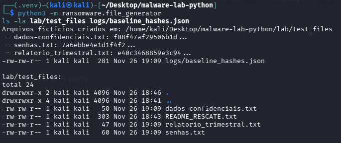
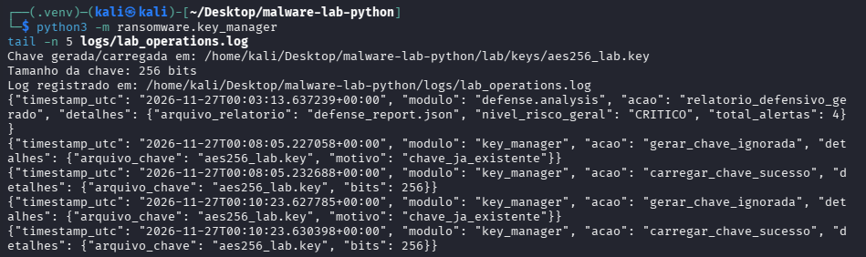
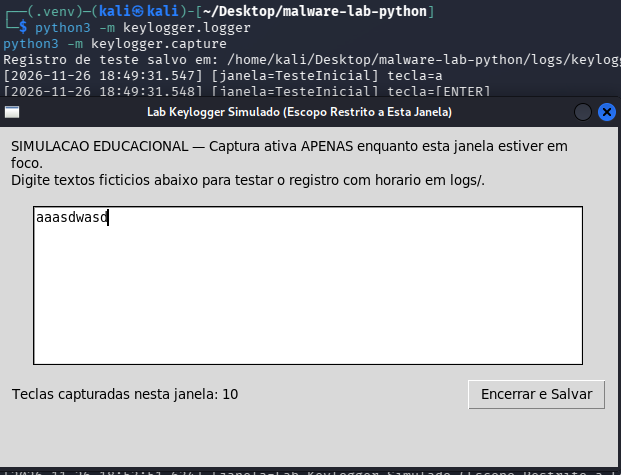
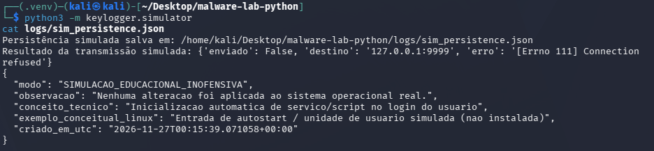
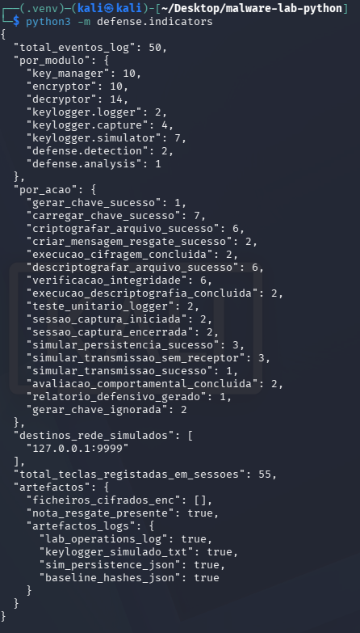
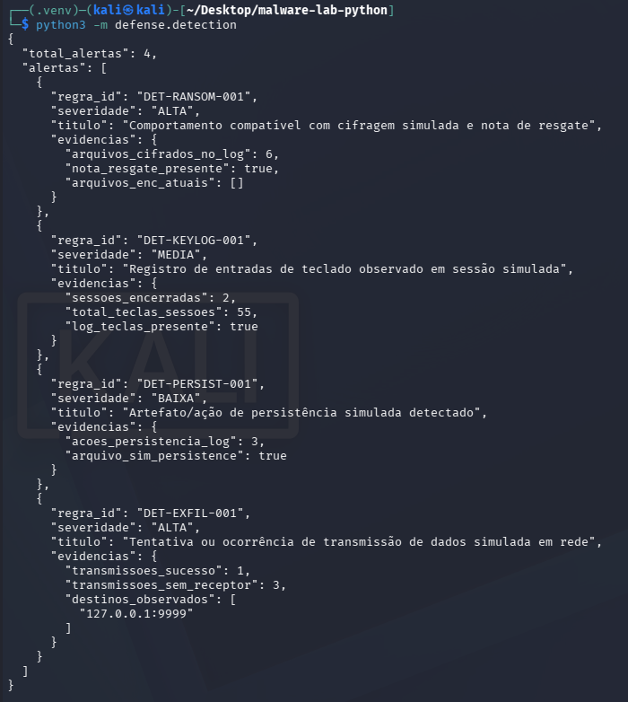
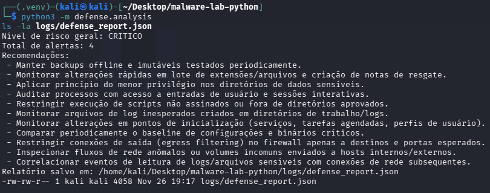

# Malware Lab em Python — Simulação Controlada e Análise Defensiva

Laboratório educacional e de portfólio em Python desenvolvido em ambiente isolado (**Kali Linux**) para simular comportamentos de **ransomware** e **keylogger** com segurança e construir um módulo de **análise e defesa** baseado em indicadores e detecção comportamental.

> **Aviso de Escopo e Segurança:** Projeto estritamente educacional e de laboratório. Todas as operações em arquivos ficam restritas ao diretório `lab/` por validação de caminhos (`pathlib`), sem *hook* global de teclado, sem alterações reais de persistência no sistema operacional e sem exfiltração externa real.

---

## Arquitetura do Projeto

- `ransomware/`
  - `file_generator.py`: gera arquivos fictícios em `lab/test_files/` e salva os hashes SHA-256 iniciais em `logs/baseline_hashes.json`.
  - `key_manager.py`: gerencia a chave simétrica AES-256 (`AESGCM`) em `lab/keys/aes256_lab.key` e registra eventos em `logs/lab_operations.log`.
  - `encryptor.py`: cifra os arquivos de teste com AES-256-GCM (`.enc`) e gera a nota fictícia `README_RESCATE.txt` em `lab/test_files/`.
  - `decrypto.py`: descriptografa os arquivos `.enc`, restaura os arquivos originais e valida a integridade SHA-256 contra `logs/baseline_hashes.json`.
- `keylogger/`
  - `logger.py`: formata e registra teclas e carimbos de data/hora em `logs/keylogger_simulado.txt`.
  - `capture.py`: janela gráfica (`tkinter`) com escopo restrito à própria janela para captura simulada.
  - `simulator.py`: simula persistência de forma inofensiva (`logs/sim_persistence.json`) e envio/transmissão local ou de laboratório.
- `defense/`
  - `indicators.py`: extrai indicadores (IOCs) dos logs e artefatos gerados no laboratório.
  - `detection.py`: aplica regras heurísticas/comportamentais e gera alertas classificados por severidade.
  - `analysis.py`: consolida indicadores e alertas, classifica o nível geral de risco e gera recomendações em `logs/defense_report.json`.
- `images/`: prints das execuções no terminal e na janela do laboratório.
- `logs/`: registros de auditoria, hashes de baseline, logs de simulação e relatórios.

---

## Preparação do Ambiente no Kali Linux

Na raiz do repositório (`~/Desktop/malware-lab-python`), crie e ative o ambiente virtual e instale as dependências:

```bash
python3 -m venv .venv
source .venv/bin/activate
pip install -r requirements.txt
```

*(Caso necessário para a janela gráfica `tkinter`: `sudo apt install -y python3-tk`)*

---

## Execução e Evidências

### 1. Módulo de Ransomware Simulado

```bash
python3 -m ransomware.file_generator
ls -la lab/test_files logs/baseline_hashes.json
```



```bash
python3 -m ransomware.key_manager
tail -n 5 logs/lab_operations.log
```



```bash
python3 -m ransomware.encryptor
ls -la lab/test_files
```


```bash
python3 -m ransomware.decrypto
ls -la lab/test_files
```


### 2. Módulo de Keylogger Simulado

```bash
python3 -m keylogger.logger
python3 -m keylogger.capture
```



```bash
python3 -m keylogger.simulator
cat logs/sim_persistence.json
```



### 3. Módulo de Análise e Defesa

```bash
python3 -m defense.indicators
```



```bash
python3 -m defense.detection
```



```bash
python3 -m defense.analysis
ls -la logs/defense_report.json
```



---

## Contramedidas e Lições Aprendidas

- **Integridade e Recuperação:** backups isolados e testados periodicamente, aliados a baselines de hash (SHA-256), permitem identificar alterações indevidas e validar a restauração dos arquivos.
- **Detecção Comportamental:** correlacionar cifragem em lote, criação de notas de resgate, registro de entradas e conexões de rede aumenta a capacidade de detecção além de assinaturas estáticas.
- **Controle de Rede e Execução:** políticas de saída no firewall (*egress filtering*), restrição de execução de scripts não confiáveis e auditoria centralizada de logs reduzem o impacto de exfiltração e ações maliciosas.